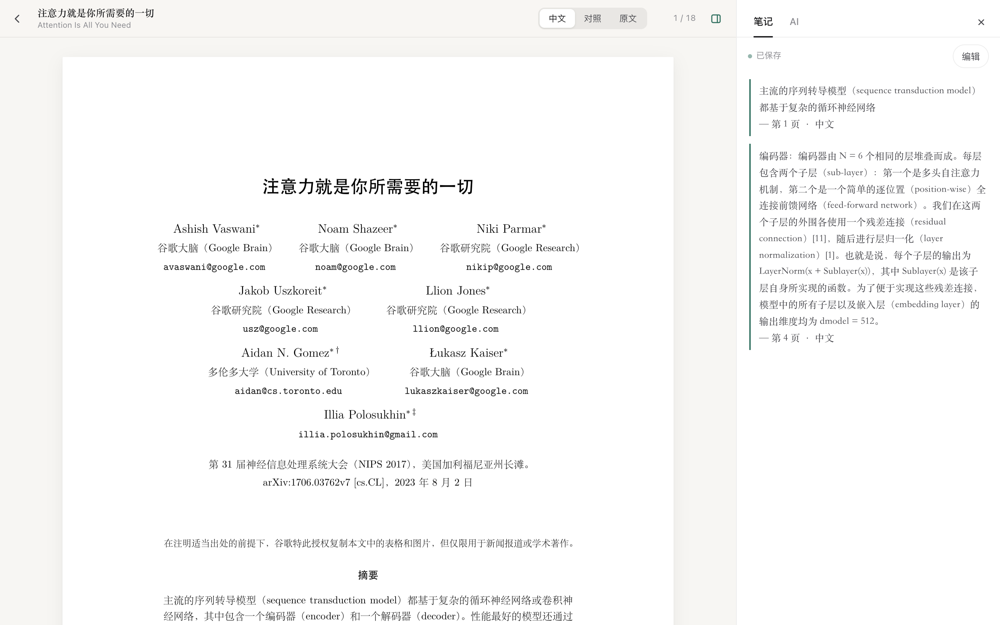

# PaperHelper

一个只在本机运行的论文阅读器：存放翻译好的论文，并排看**中文 / 中英对照 / 原文**，在旁边写 Markdown 笔记，用内置的 AI 助手查找、整理论文，或者就一篇论文提问。

论文的翻译交给 Claude Code 或 Codex：把一篇外文 PDF 交给它，它会用仓库里附带的翻译 skill 译成 LaTeX 排版的中文版和中英对照版，自己挑一个分类归档，然后打开 PaperHelper。



## 功能

- **论文库**：按分类列出全部论文，分类由 AI 决定，不用手动整理文件。`⌘K` 搜索标题、作者、分类，也可以直接把问题交给 AI 助手。
- **阅读**：基于 PDF.js，中文 / 对照 / 原文一键切换，切换时尽量停在同一位置。
- **摘录与笔记**：在论文里选中一段文字，点「摘录到笔记」，原文会以引用块的形式加入笔记，并自动标上页码和版本。笔记是普通的 Markdown 文件（每篇论文一个 `notes.md`），自动保存，Claude Code / Codex 和 AI 助手都能直接读写。
- **AI 助手（DeepSeek）**：在阅读页针对当前论文问答（会按页读取全文）；在论文库页查找论文、重新分类、整理笔记。界面会先显示它执行的每一步，再给出回答。
- **极简界面**：自动跟随系统的浅色 / 深色模式；除了调用 DeepSeek，其余都离线运行。

## 安装（macOS）

需要：Python 3.9 及以上（系统自带的即可）、Google Chrome（可选，会以独立窗口打开）。如果要用翻译功能，还需要 [Claude Code](https://claude.com/claude-code) 或 [Codex](https://developers.openai.com/codex)（二选一即可），以及带 XeLaTeX 的 TeX 发行版（例如 `brew install texlive`）。

```bash
git clone https://github.com/csdiyfree/PaperHelper.git ~/PaperHelper
~/PaperHelper/install.sh
```

`install.sh` 会做三件事：
1. 生成 `~/Applications/PaperHelper.app`，可以从启动台或 Spotlight 打开；
2. 把翻译 skill 安装到 `~/.claude/skills/`（Claude Code）和 `~/.codex/skills/`（Codex），装了哪个就装到哪个；
3. 检查 Python 环境。入库时提取论文文字需要 PyMuPDF（`python3 -m pip install PyMuPDF`）。

第一次打开后，点左下角的齿轮（或按 `⌘,`）填入 DeepSeek API key。key 只保存在本机的 `~/PaperHelper/config.json`。

## 使用

- **打开**：双击 PaperHelper，或运行 `~/PaperHelper/bin/paperhelper open`。
- **导入新论文**：在 Claude Code 或 Codex 里说「翻译这篇论文 /path/to/paper.pdf」。完成后论文会自动归类到论文库，并打开 PaperHelper。

  > **导入论文只能通过装好翻译 skill 的 Claude Code 或 Codex 进行，软件里没有上传入口。** 这是为了保证翻译质量：翻译由能逐段阅读、核对的编程智能体完成，按 LaTeX 重新排版，公式、图表编号和参考文献都和原文一一对应，并且自动核对中英段落是否对齐。软件本身只负责阅读、笔记和整理。

  - **用 Codex 时**，建议在 `~/PaperHelper` 里启动它（`cd ~/PaperHelper && codex`）：Codex 的沙盒只允许写当前目录，这样翻译稿和论文库才能直接写入。最后打开 PaperHelper 窗口这一步要访问本机服务，Codex 会请你批准一次。
  - 沙盒里用不了 macOS 的部分系统字体，这时编译会自动改用 TeX Live 自带的 Fandol 字体，排版不受影响，只是字形不同。
- **整理**：让 AI 助手做，例如「把 BERT 移到预训练语言模型」「找出讲注意力机制的论文」。

命令行工具：

```text
paperhelper open [id]      启动并打开（可直接定位到某篇论文）
paperhelper start | stop   后台服务
paperhelper categories     分类及篇数
paperhelper list           全部论文
paperhelper path <id>      论文所在文件夹
paperhelper ingest ...     把一篇译好的论文放进论文库（翻译 skill 的最后一步会调用）
```

## 目录结构

```text
app/server.py        本地服务（仅用 Python 标准库，监听 127.0.0.1:4730）
app/web/             前端（原生 HTML / CSS / JS，第三方库放在 vendor/）
bin/paperhelper      命令行工具
macos/build-app.sh   生成 PaperHelper.app
skill/               翻译 skill，Claude Code 和 Codex 通用（见 skill/README.md）
DESIGN.md            接口与数据格式约定
AGENTS.md            给 Codex / Claude Code 的项目说明（CLAUDE.md 引用它）
library/             你的论文（不进 git）
config.json          API key（不进 git）
```

每篇论文是 `library/<分类>/<id>/` 下的一个文件夹：`original.pdf`、`zh.pdf`、`bilingual.pdf`、`notes.md`、`meta.json`、`text/`（提取出的全文）、`latex/`（译稿源码）。

## 致谢

- 翻译 skill 基于 [a19394263615-dotcom/academic-pdf-translator](https://github.com/a19394263615-dotcom/academic-pdf-translator)（MIT），改动见 [skill/README.md](skill/README.md)。
- [pdf.js](https://github.com/mozilla/pdf.js)（Apache-2.0）和 [marked](https://github.com/markedjs/marked)（MIT），见 [app/web/vendor](app/web/vendor/README.md)。

## 许可证

[MIT](LICENSE)
